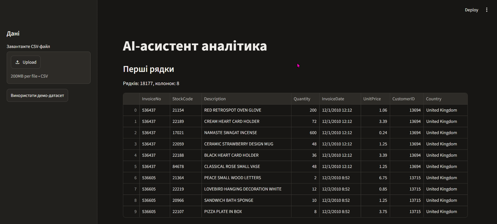
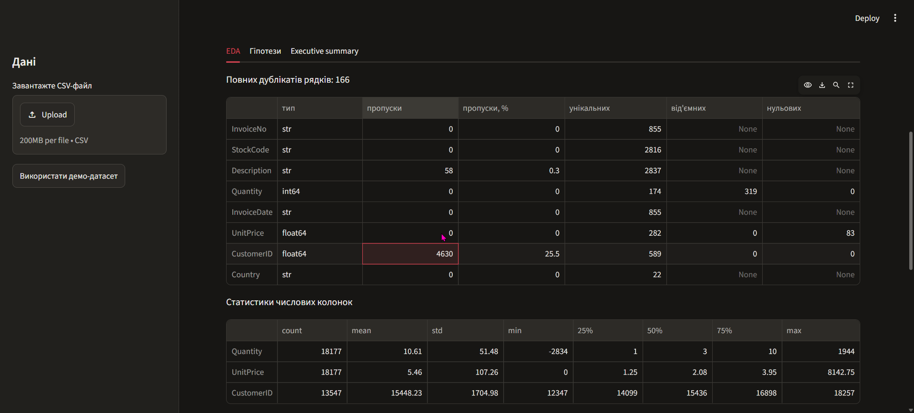
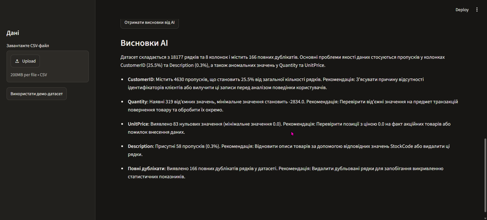
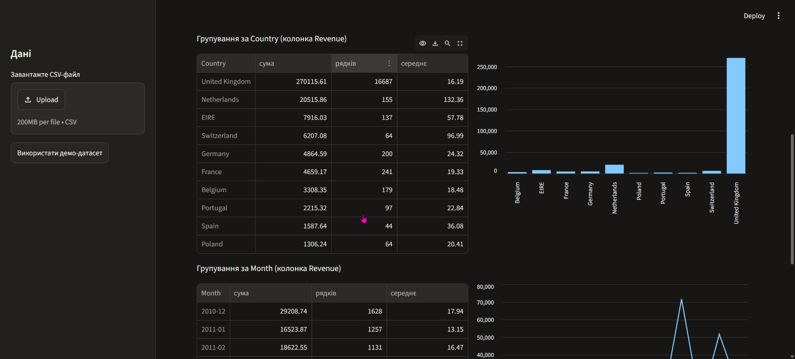
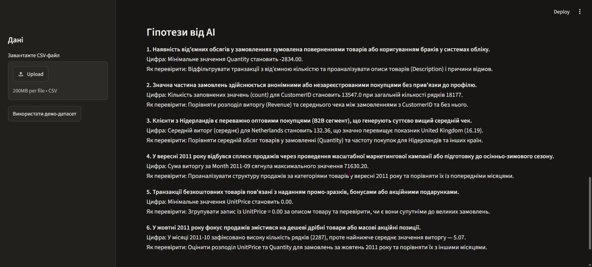
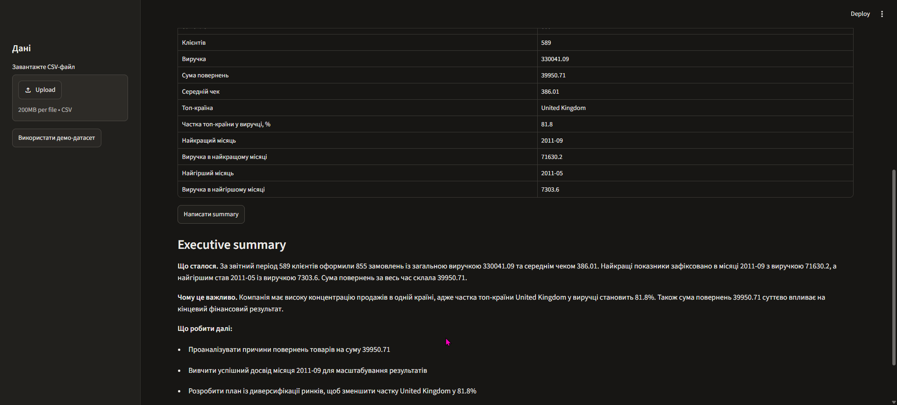
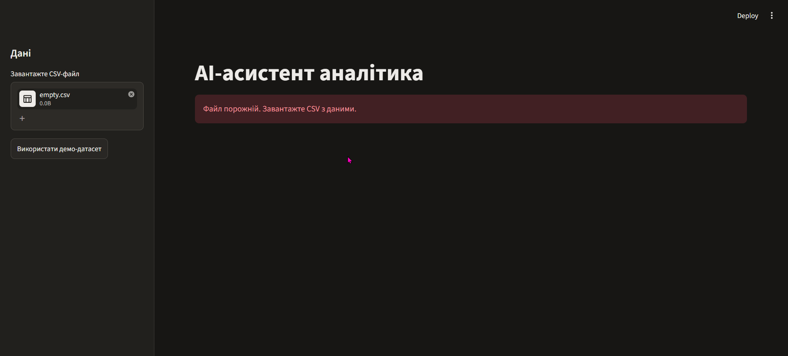

# AI-асистент аналітика

Веб-застосунок на Streamlit, який допомагає швидко розібратися з CSV-файлом. Ви завантажуєте таблицю, а застосунок перевіряє якість даних, пропонує гіпотези та пише короткий звіт для керівника.

Усі числа рахує pandas, а AI (Google Gemini) тільки пише текст на основі цих готових чисел. Поруч з кожною відповіддю AI показані таблиці pandas, тож будь-яку цифру можна перевірити.

## Скріншоти

**Завантажені дані.** Перші рядки таблиці і розмір датасету.



**EDA.** Таблиця з типами колонок, пропусками, від'ємними і нульовими значеннями, яку рахує pandas.



Під таблицею висновки AI про якість даних. Цифри в тексті ті самі, що в таблиці вище.



**Гіпотези.** Групування за країнами і місяцями з графіками.



Під ними гіпотези від AI. Кожна гіпотеза спирається на цифру з таблиць.



**Executive summary.** Ключові метрики і короткий звіт: що сталося, чому це важливо, що робити далі.



**Обробка помилки.** Якщо завантажити порожній файл, застосунок показує зрозуміле повідомлення замість падіння.



## Запуск на Windows

Потрібен Python 3.10 або новіший.

1. Завантажте проєкт і перейдіть у папку:
   ```
   git clone https://github.com/absoluteHub/ai-analyst.git
   cd ai-analyst
   ```
2. Створіть віртуальне середовище і встановіть бібліотеки:
   ```
   py -m venv .venv
   .venv\Scripts\activate
   pip install -r requirements.txt
   ```
3. Отримайте ключ Gemini:
   - зайдіть на [Google AI Studio](https://aistudio.google.com/apikey) під своїм Google-акаунтом;
   - натисніть "Create API key" і скопіюйте ключ.
4. Скопіюйте файл `.env.example` у `.env`:
   ```
   copy .env.example .env
   ```
   Відкрийте `.env` і вставте свій ключ замість `your_key_here`. Файл `.env` не потрапляє в git, тому ключ лишається тільки у вас.
5. Запустіть застосунок:
   ```
   streamlit run app.py
   ```
   Він відкриється в браузері. Зліва завантажте свій CSV або натисніть "Використати демо-датасет".

Якщо Gemini пише, що модель перевантажена (помилка 503), замініть у `.env` модель на іншу безкоштовну, наприклад `GEMINI_MODEL=gemini-3.6-flash`.

## Що вміє

1. **Автоматичний EDA.** Pandas рахує типи колонок, пропуски, дублікати, базові статистики, від'ємні і нульові значення. AI пише висновки про якість даних і що з цим робити.
2. **Генерація гіпотез.** Pandas групує дані за країнами і місяцями (сума, кількість, середнє). AI пропонує 5-7 гіпотез, у кожній конкретна цифра з цих таблиць.
3. **Executive summary.** Pandas рахує виручку, кількість замовлень, середній чек, топ-країну, повернення, найкращий і найгірший місяць. AI пише короткий текст для керівника.

AI запускається кнопкою на кожній вкладці і відповідає у форматі JSON. Якщо файл порожній, немає ключа або AI повернув помилку, застосунок показує повідомлення і не падає.

Промпти і пояснення до них лежать у [prompts.md](prompts.md).

## Технології

- Python
- Streamlit (інтерфейс і графіки)
- pandas (усі розрахунки)
- Google Gemini через `google-genai`
- `python-dotenv` (ключ і назва моделі з `.env`)

## Датасет

[E-Commerce Data](https://www.kaggle.com/datasets/carrie1/ecommerce-data) з Kaggle. Це продажі британського онлайн-магазину за грудень 2010 - грудень 2011, оригінал лежить в [UCI Machine Learning Repository](https://archive.ics.uci.edu/dataset/352/online+retail).

Повний файл великий (понад 540 тисяч рядків), тому в репозиторії лежить вибірка `data/sample.csv` на 18 тисяч рядків. Її робить скрипт `prepare_data.py`: він бере випадкові замовлення цілком, щоб не розривати їх. Якщо хочете зробити вибірку самі, покладіть повний файл у `data/data.csv` і запустіть `python prepare_data.py`.
